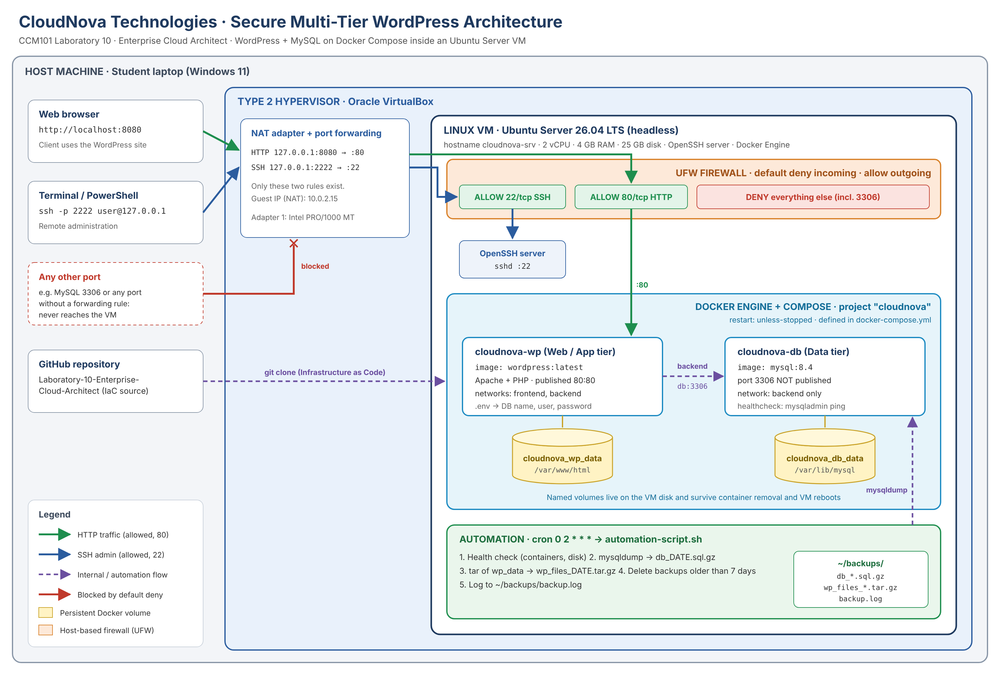

# Laboratory 10 - Mission 10: The Enterprise Cloud Architect

**CCM101 - Cloud Computing** · CloudNova Technologies

**Project:** Secure Multi-Tier Web Application (CloudNova Portal)
**Application stack:** WordPress + MySQL on Docker Compose
**Platform:** Oracle VirtualBox · Ubuntu Server 26.04 LTS (headless)
**Prepared by:** [Member 1] | [Member 2] | [Member 3] | [Member 4] · **Section:** [BSIT 2A]

---

## Overview

This folder holds the complete infrastructure for our final mission: a production-style private cloud environment that is **multi-tier, persistent, secure, automated and documented**.

- **Web/app tier:** WordPress (Apache + PHP) in container `cloudnova-wp`, the only public service (port 80).
- **Data tier:** MySQL 8.4 in container `cloudnova-db`, reachable only through a private Docker network.
- **Persistence:** named volumes `cloudnova_db_data` and `cloudnova_wp_data` survive restarts and VM reboots.
- **Security:** UFW with default deny incoming; only 22/tcp (SSH) and 80/tcp (HTTP) allowed.
- **Automation:** `automation-script.sh` runs every day at 02:00 through cron; it checks health, backs up the database and site files, and keeps 7 days of backups.

## Architecture



## Repository contents

| File | Description |
|---|---|
| [`docker-compose.yml`](docker-compose.yml) | Infrastructure as Code: WordPress + MySQL, volumes, networks, health check |
| [`.env.example`](.env.example) | Template for secrets; copy to `.env` (never committed) |
| [`.gitignore`](.gitignore) | Keeps `.env` and backup files out of Git |
| [`automation-script.sh`](automation-script.sh) | Executable Bash script: health check, database and file backup, retention, logging |
| [`architecture-diagram.png`](architecture-diagram.png) | Topology: host, hypervisor, Linux VM, firewall, Docker containers |
| [`operational-manual.md`](operational-manual.md) | Handover manual: deploy, secure, maintain, recover, troubleshoot |
| `operational-manual.pdf` | Print version of the manual (5.5 x 8.5 in, portrait) |
| [`final-reflection.md`](final-reflection.md) | Our reflection from Mission 1 to Mission 10 |
| [`screenshots/`](screenshots/) | Evidence of the working system |

## Quick start

On a fresh Ubuntu Server (or a KillerCoda Ubuntu playground) with Docker installed. Run each block separately; `nano` and `sudo ufw enable` wait for your input, so they are on their own.

**1. Get the code**

```bash
git clone https://github.com/<YOUR-USERNAME>/<CCM101-yourname>.git
cd <CCM101-yourname>/Laboratory-10-Enterprise-Cloud-Architect
cp .env.example .env
```

**2. Set the passwords** (letters, numbers, `_` and `-` only), then save with Ctrl+O, Enter, Ctrl+X

```bash
nano .env
```

**3. Deploy**

```bash
chmod 600 .env
docker compose up -d
docker compose ps
```

**4. Firewall**

```bash
sudo ufw default deny incoming
sudo ufw default allow outgoing
sudo ufw allow 22/tcp
sudo ufw allow 80/tcp
```

```bash
sudo ufw enable
```

Type `y` when asked, then:

```bash
sudo ufw status verbose
```

**5. Automation**

```bash
chmod +x automation-script.sh
./automation-script.sh
mkdir -p ~/backups
JOB="0 2 * * * $(pwd)/automation-script.sh >> $HOME/backups/cron.log 2>&1"
(crontab -l 2>/dev/null; echo "$JOB") | crontab -
crontab -l
```

Open **http://localhost:8080** on the host laptop (VirtualBox forwards host 8080 to guest 80). The full procedure is in the [Operational Manual](operational-manual.md).

## How each requirement is met

| Requirement | Where it is met |
|---|---|
| 1. Base infrastructure and design | `architecture-diagram.png`; VirtualBox VM with Ubuntu Server; NAT port forwarding 8080 → 80 and 2222 → 22 (Manual §4.1) |
| 2. Infrastructure integration | Docker + Compose installed (Manual §4.4); `docker-compose.yml` with two linked containers; database on persistent volume `cloudnova_db_data` (Manual §4.9) |
| 3. Security hardening | UFW enabled, default deny incoming, only 22/tcp and 80/tcp allowed; database port never published (Manual §5) |
| 4. Automation | Executable `automation-script.sh`; cron job `0 2 * * *` (Manual §6) |
| 5. Technical documentation | `operational-manual.md` (+ print PDF), raw code in this folder, `final-reflection.md` |

## Evidence

Screenshots are in [`screenshots/`](screenshots/). See [`screenshots/README.md`](screenshots/README.md) for the list.

| Evidence | File |
|---|---|
| WordPress site from the host browser | `screenshots/05-wordpress-site.png` |
| Containers running and healthy | `screenshots/04-compose-ps.png` |
| Data still there after VM reboot | `screenshots/06-persistence-after-reboot.png` |
| UFW status | `screenshots/07-ufw-status.png` |
| Backup run and files | `screenshots/09-backup-run.png` |
| Cron job | `screenshots/10-crontab.png` |

## Sources

- Docker Docs: https://docs.docker.com/engine/install/ubuntu/ and https://docs.docker.com/reference/compose-file/
- Docker Hub official images `wordpress` and `mysql`: https://hub.docker.com/
- Ubuntu Server documentation: https://ubuntu.com/server/docs
- Oracle VirtualBox User Manual: https://www.virtualbox.org/manual/
- MySQL 8.4 Reference Manual (mysqldump): https://dev.mysql.com/doc/refman/8.4/en/mysqldump.html

## AI use disclosure

[State honestly which AI tools you used and for what, as required by the CCM101 Academic Integrity Policy. Example: "We used an AI assistant to clarify concepts, review our commands and draft parts of the documentation. We tested every command on our own VM, revised the text, and wrote the final reflection ourselves."]
