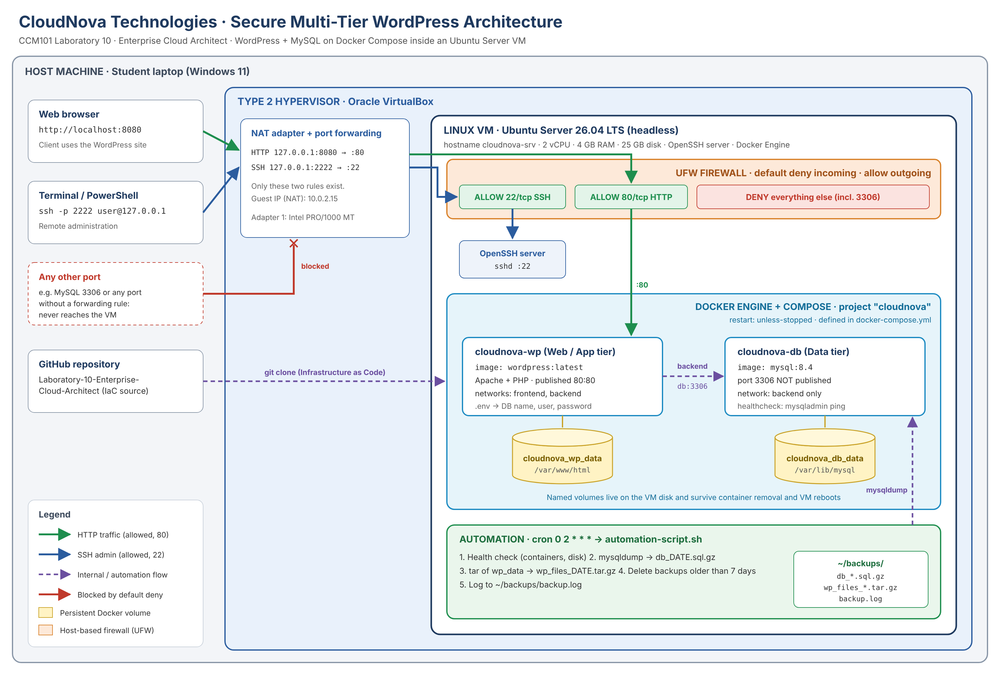

<div align="center">

# CCM101 - Cloud Computing

## Enterprise Cloud Architect - Operational Manual

**Project:** Secure Multi-Tier Web Application (CloudNova Portal)

**Application Stack:** WordPress + MySQL

**Prepared by:** Bustria, Gibzen | Seminiano, Jake | Pascua, John Cyrom | Urbino, Jethrone | Velicaria, John Henrick

**Section:** BSIT 4H

**Instructor:** Torres, Jenkielyn C.

**Date:** November 6, 2026

</div>

<div class="pagebreak"></div>

## Table of Contents

1. Executive Summary
2. System Architecture
3. Prerequisites
4. Deployment Procedure
5. Security Hardening
6. Automation and Backup
7. Maintenance and Disaster Recovery
8. Verification Checklist
9. Troubleshooting
10. Appendix: Command Reference and Sources

<div class="pagebreak"></div>

## 1. Executive Summary

CloudNova Technologies was asked to deliver a highly secure, automated and observable private cloud environment. This manual is the handover document for the client's IT team. It explains how to deploy, secure and maintain the system.

The system runs a **WordPress** website (web and application tier) backed by a **MySQL** database (data tier). Both run as **Docker containers** defined in one Infrastructure-as-Code file, `docker-compose.yml`, on a headless **Ubuntu Server** virtual machine.

What the client gets:

| Goal | How it is met |
|---|---|
| Multi-tier | WordPress and MySQL run as two separate, linked containers. |
| Persistent | Database and site files live in named Docker volumes that survive restarts and VM reboots. |
| Secure | UFW firewall with a default deny policy; only SSH (22) and HTTP (80) are open; the database is never exposed. |
| Self-backing-up | A Bash script backs up the database and site files every night at 02:00 through cron, and keeps 7 days of backups. |
| Observable | Every backup run logs container status and disk usage to `~/backups/backup.log`. |
| Reproducible | The whole stack can be rebuilt on a new server from the GitHub repository in a few minutes. |

<div class="pagebreak"></div>

## 2. System Architecture



### 2.1 Layers

| Layer | Component | Role |
|---|---|---|
| Host | Student laptop (Windows 11) | Runs the hypervisor; the browser and terminal reach the VM through port forwarding. |
| Hypervisor | Oracle VirtualBox (Type 2) | Runs the VM; its NAT adapter forwards only two ports. |
| Virtual machine | Ubuntu Server 26.04 LTS, headless, hostname `cloudnova-srv` | 2 vCPU, 4 GB RAM, 25 GB disk, OpenSSH server. |
| Firewall | UFW (Uncomplicated Firewall) | Default deny incoming; allows 22/tcp and 80/tcp only. |
| Container engine | Docker Engine + Docker Compose plugin | Runs the stack defined in `docker-compose.yml` (project `cloudnova`). |
| Web/app tier | `cloudnova-wp` (`wordpress:latest`) | Apache + PHP + WordPress; the only container with a published port (80). |
| Data tier | `cloudnova-db` (`mysql:8.4`) | Stores all WordPress data; no published port; reachable only from WordPress. |
| Storage | Volumes `cloudnova_db_data`, `cloudnova_wp_data` | Persistent data on the VM disk. |
| Automation | cron + `automation-script.sh` | Nightly health check, database and file backups, 7-day retention. |

### 2.2 Ports and traffic

| Purpose | Host (laptop) | VM / guest | Firewall | Container |
|---|---|---|---|---|
| Website | `127.0.0.1:8080` | `:80` | ALLOW 80/tcp | `cloudnova-wp :80` |
| Administration | `127.0.0.1:2222` | `:22` | ALLOW 22/tcp | none (OpenSSH on the VM) |
| Database | not forwarded | not published | DENY | `cloudnova-db :3306` on the private `backend` network only |

### 2.3 Docker networks

- **frontend**: WordPress only.
- **backend**: WordPress and MySQL. WordPress reaches the database by the service name `db` on port 3306. Nothing outside Docker can reach it.

<div class="pagebreak"></div>

## 3. Prerequisites

**Hardware (host laptop)**

- 64-bit CPU with virtualization (Intel VT-x or AMD-V) enabled in BIOS/UEFI.
- At least 8 GB RAM (4 GB goes to the VM) and 40 GB free disk space.

**Software**

- Oracle VirtualBox (latest), from virtualbox.org.
- Ubuntu Server LTS ISO (amd64, the `live-server` image), from ubuntu.com/download/server.
- A web browser and an SSH client (PowerShell, macOS Terminal, or Linux terminal).
- A GitHub account with this repository.

**Skills**

- Basic Linux commands, editing with `nano`, and using SSH.

**Internet access** is needed during installation to download packages and Docker images.

<div class="pagebreak"></div>

## 4. Deployment Procedure

### 4.1 Create the virtual machine

1. In VirtualBox click **New**.
2. Name `cloudnova-vm`, ISO image: the Ubuntu Server ISO, type Linux / Ubuntu (64-bit). **Untick** *Proceed with Unattended Installation*.
3. Base memory **4096 MB**, processors **2**.
4. Create a virtual hard disk of **25 GB** (VDI, dynamically allocated). Click **Finish**.
5. **Settings > System > Processor**: confirm Processing Cap is **100%**.
6. **Settings > Network > Adapter 1**: Attached to **NAT**. Click **Advanced > Port Forwarding** and add:

| Name | Protocol | Host IP | Host Port | Guest IP | Guest Port |
|---|---|---|---|---|---|
| SSH | TCP | 127.0.0.1 | 2222 | (blank) | 22 |
| HTTP | TCP | 127.0.0.1 | 8080 | (blank) | 80 |

### 4.2 Install Ubuntu Server

Start the VM and choose **Try or Install Ubuntu Server**. In the installer:

1. Language English; keyboard English (US); type **Ubuntu Server**.
2. Network: keep DHCP (address like 10.0.2.15). Proxy blank. Mirror default.
3. Storage: **Use an entire disk**, then **Done**, then **Continue**.
4. Profile: your name, server name `cloudnova-srv`, a username and a strong password.
5. Ubuntu Pro: **Skip for now**.
6. SSH: tick **Install OpenSSH server**.
7. Featured snaps: select nothing.
8. When the install finishes choose **Reboot Now** (press Enter if asked to remove the installation medium).

### 4.3 First boot

Log in on the VM console, then update the system:

```bash
sudo apt update && sudo apt upgrade -y
sudo timedatectl set-timezone Asia/Manila
```

From now on, administer the server from the laptop over SSH:

```bash
ssh -p 2222 <username>@127.0.0.1
```

### 4.4 Install Docker Engine and Docker Compose

We installed Docker from the Ubuntu repository, which is the simplest method (one package for the engine, one for the Compose plugin):

```bash
sudo apt update
sudo apt install -y docker.io docker-compose-v2 git
sudo systemctl enable --now docker
sudo usermod -aG docker $USER
```

Log out (`exit`) and log back in so the `docker` group applies, then check:

```bash
docker run hello-world
docker --version
docker compose version
```

Alternative: Docker's official repository (docs.docker.com/engine/install/ubuntu) provides the `docker-ce` and `docker-compose-plugin` packages. Use it only if Docker publishes packages for your Ubuntu release (`apt update` shows no 404 for download.docker.com).

### 4.5 Get the infrastructure code

```bash
cd ~
git clone https://github.com/<YOUR-USERNAME>/<CCM101-yourname>.git
cd <CCM101-yourname>/Laboratory-10-Enterprise-Cloud-Architect
```

### 4.6 Set the secrets

```bash
cp .env.example .env
```

```bash
nano .env
```

Set strong values for `DB_PASSWORD` and `DB_ROOT_PASSWORD` (letters, numbers, `_` and `-` only; Compose treats `$` and quotes specially), then save with Ctrl+O, Enter, Ctrl+X. Restrict the file so only the owner can read it:

```bash
chmod 600 .env
```

`.env` is in `.gitignore`, so passwords never reach GitHub.

### 4.7 Deploy the stack

```bash
docker compose config --quiet   # validates the file (no output = OK)
docker compose up -d            # pulls images, creates networks, volumes, containers
docker compose ps               # db should be "healthy", wordpress "running"
```

### 4.8 Finish the WordPress setup

1. On the laptop, open **http://localhost:8080**.
2. Choose the language, then fill in site title (CloudNova Portal), admin username, strong password and email.
3. Log in at **http://localhost:8080/wp-admin** and publish a test post called *Persistence Test*.

### 4.9 Prove persistence

```bash
docker compose down        # removes containers, KEEPS volumes
docker compose up -d       # the test post is still there
```

Then reboot the VM (this closes the SSH session):

```bash
sudo reboot
```

Reconnect after about a minute; the containers started by themselves:

```bash
cd <CCM101-yourname>/Laboratory-10-Enterprise-Cloud-Architect
docker compose ps
docker volume ls           # cloudnova_db_data and cloudnova_wp_data
```

**Warning:** `docker compose down -v` deletes the volumes and all data. Never use `-v` on the production server.

<div class="pagebreak"></div>

## 5. Security Hardening

### 5.1 Firewall (UFW) with default deny

Allow SSH **before** enabling the firewall, or you will lock yourself out.

```bash
sudo ufw default deny incoming
sudo ufw default allow outgoing
sudo ufw allow 22/tcp comment 'SSH remote administration'
sudo ufw allow 80/tcp comment 'WordPress HTTP'
```

Enable the firewall with a separate command. It asks *Proceed with operation (y|n)?*, so type `y`:

```bash
sudo ufw enable
```

```bash
sudo ufw status verbose
```

Expected result:

```
Status: active
Default: deny (incoming), allow (outgoing), deny (routed)
To                         Action      From
--                         ------      ----
22/tcp                     ALLOW IN    Anywhere    # SSH remote administration
80/tcp                     ALLOW IN    Anywhere    # WordPress HTTP
```

### 5.2 Why only these ports

| Port | Decision | Reason |
|---|---|---|
| 22/tcp | Allowed | Remote administration over SSH. |
| 80/tcp | Allowed | The client website. |
| 3306/tcp | Not opened, not published | The database must never be reachable from outside; only WordPress talks to it over the private Docker network. |
| Everything else | Denied | Least privilege: anything not explicitly needed is closed. |

### 5.3 Verify the lock-down

```bash
sudo ss -tulpn             # 3306 is not listening on the host
docker compose ps          # db shows no published port
sudo ufw status numbered
```

### 5.4 Docker and UFW

Docker writes its own iptables rules, so a port published with `ports:` can be reached even if UFW does not list it. This design avoids the risk by **publishing only port 80**, which UFW also allows. The database has no `ports:` entry at all. For stricter control, ports can be bound to `127.0.0.1` or rules added to the `DOCKER-USER` chain.

### 5.5 Additional hardening (recommended)

```bash
sudo ufw limit 22/tcp                      # rate-limit SSH brute force
sudo apt install -y unattended-upgrades    # automatic security updates
sudo apt install -y fail2ban               # ban repeated failed logins
```

Disable root login over SSH: in `/etc/ssh/sshd_config` set `PermitRootLogin no`, then run `sudo systemctl restart ssh`.

### 5.6 Secrets handling

- Real passwords live only in `.env` on the server (permissions 600).
- The repository contains `.env.example` with placeholder values.
- The backup script reads the database password from inside the container, so no password is written in any script.

<div class="pagebreak"></div>

## 6. Automation and Backup

### 6.1 What `automation-script.sh` does

| Step | Action | Output |
|---|---|---|
| 1 | Health check: stops with an error if `cloudnova-db` is not running; logs container status and disk usage. | `backup.log` |
| 2 | Database dump with `mysqldump --single-transaction`, compressed. | `db_YYYY-MM-DD_HH-MM-SS.sql.gz` |
| 3 | Archive of the `cloudnova_wp_data` volume (themes, plugins, uploads) using a temporary Alpine container. | `wp_files_YYYY-MM-DD_HH-MM-SS.tar.gz` |
| 4 | Retention: deletes backups older than 7 days. | fewer old files |
| 5 | Logs every step with a timestamp. | `~/backups/backup.log` |

### 6.2 Make it executable and test it

```bash
chmod +x automation-script.sh
ls -l automation-script.sh      # -rwxr-xr-x
./automation-script.sh
ls -lh ~/backups
cat ~/backups/backup.log
```

### 6.3 Schedule it with cron (every day at 02:00)

Run this from inside the Laboratory-10 folder. `$(pwd)` writes the full path into the crontab:

```bash
mkdir -p ~/backups
JOB="0 2 * * * $(pwd)/automation-script.sh >> $HOME/backups/cron.log 2>&1"
(crontab -l 2>/dev/null; echo "$JOB") | crontab -
crontab -l
sudo systemctl enable --now cron
```

| Field | minute | hour | day of month | month | day of week |
|---|---|---|---|---|---|
| Value | 0 | 2 | * | * | * |
| Meaning | at minute 0 | 2 AM | every day | every month | every weekday |

To demonstrate cron live, temporarily set the job 2 minutes ahead (edit with `crontab -e`), wait, then check:

```bash
ls -lh ~/backups
grep CRON /var/log/syslog | tail      # or: journalctl -u cron --since "10 min ago"
```

Then set the time back to `0 2 * * *`.

<div class="pagebreak"></div>

## 7. Maintenance and Disaster Recovery

### 7.1 Daily operations

| Task | Command |
|---|---|
| Status | `docker compose ps` |
| Logs | `docker compose logs -f wordpress` / `docker compose logs -f db` |
| Restart one service | `docker compose restart wordpress` |
| Stop / start stack | `docker compose down` / `docker compose up -d` |
| Disk usage | `df -h` and `docker system df` |
| Last backup result | `tail -20 ~/backups/backup.log` |

### 7.2 Updating images

```bash
./automation-script.sh            # take a fresh backup first
docker compose pull               # download newer images
docker compose up -d              # recreate containers; volumes are kept
docker image prune -f             # remove old unused images
```

### 7.3 Restore the database from a backup

Use this when posts or settings are lost or damaged.

```bash
ls -lh ~/backups                                  # pick a backup file
gunzip -c ~/backups/db_YYYY-MM-DD_HH-MM-SS.sql.gz | \
  docker exec -i cloudnova-db sh -c 'mysql -uroot -p"$MYSQL_ROOT_PASSWORD" "$MYSQL_DATABASE"'
```

Reload the website to confirm the content is back.

### 7.4 Restore the WordPress files

```bash
docker compose stop wordpress
docker run --rm -v cloudnova_wp_data:/data -v ~/backups:/backup alpine \
  sh -c "rm -rf /data/* && tar xzf /backup/wp_files_YYYY-MM-DD_HH-MM-SS.tar.gz -C /data"
docker compose start wordpress
```

### 7.5 Full rebuild on a new server

1. Install Ubuntu Server, Docker and the firewall (Sections 4 and 5).
2. `git clone` the repository and create `.env` (use the same passwords as before).
3. `docker compose up -d`.
4. Copy the backup files to `~/backups` on the new server and restore them (7.3 and 7.4).
5. Install the cron job (6.3).

<div class="pagebreak"></div>

## 8. Verification Checklist

| # | Check | Command / action | Expected |
|---|---|---|---|
| 1 | Website reachable from host | Browser: http://localhost:8080 | WordPress site loads |
| 2 | SSH works | `ssh -p 2222 <user>@127.0.0.1` | Login prompt |
| 3 | Two linked containers | `docker compose ps` | `cloudnova-wp` running, `cloudnova-db` healthy |
| 4 | Persistent volumes | `docker volume ls` | `cloudnova_db_data`, `cloudnova_wp_data` |
| 5 | Survives reboot | `sudo reboot`, then reload site | Test post still there |
| 6 | Firewall active | `sudo ufw status verbose` | active, deny incoming, only 22 and 80 |
| 7 | DB not exposed | `sudo ss -tulpn` | no 3306 on the host |
| 8 | Script executable | `ls -l automation-script.sh` | `-rwxr-xr-x` |
| 9 | Backup works | `./automation-script.sh` | new files in `~/backups` |
| 10 | Cron scheduled | `crontab -l` | `0 2 * * * .../automation-script.sh` |
| 11 | Restore works | Section 7.3 | deleted post comes back |

<div class="pagebreak"></div>

## 9. Troubleshooting

| Symptom | Likely cause | Fix |
|---|---|---|
| VM will not start, no 64-bit option | Virtualization disabled or Hyper-V conflict | Enable VT-x/AMD-V in BIOS; turn off Hyper-V if needed. |
| VM error `VERR_FILE_NOT_FOUND` on `.vdi` | Virtual disk file deleted or moved | Recreate the VM disk; do not delete files inside `VirtualBox VMs`. |
| VM is extremely slow | Processing Cap set below 100% | Settings > System > Processor > Processing Cap 100%. |
| `localhost:8080` does not load | Missing forward rule, UFW blocks 80, containers down | Check the VirtualBox rule, `sudo ufw status`, `docker compose ps`. |
| SSH refused on 2222 | OpenSSH not installed / not running | `sudo apt install -y openssh-server`; `sudo systemctl enable --now ssh`. |
| Locked out after `ufw enable` | SSH was not allowed first | Use the VirtualBox console: `sudo ufw allow 22/tcp`. |
| `permission denied ... docker.sock` | User not in docker group | `sudo usermod -aG docker $USER`, then log out and in. |
| "Error establishing a database connection" | DB still starting, or wrong `.env` | `docker compose logs db`; fix `.env`. If the volume was created with old passwords, the new `.env` will not change them. |
| "variable is not set" warnings | `.env` missing or wrong folder | Run compose from the folder that contains `.env`. |
| Port 80 already in use | Apache or nginx on the VM | `sudo ss -tulpn \| grep :80`, stop that service. |
| Cron job does nothing | Wrong path, not executable, cron stopped | `crontab -l`, `chmod +x`, `cat ~/backups/cron.log`, `sudo systemctl status cron`. |
| Backup volume not found | Compose project name changed | Keep `name: cloudnova`, or check `docker volume ls` and edit `WP_VOLUME`. |
| Data gone after restart | `down -v` used | Restore from `~/backups` (Section 7.3). |
| Forgot VM password | Lost credentials | GRUB > Advanced options > recovery mode > root shell > `mount -o remount,rw /` > `passwd <user>`. |

<div class="pagebreak"></div>

## 10. Appendix: Command Reference and Sources

### 10.1 Files in this repository

| File | Purpose |
|---|---|
| `docker-compose.yml` | Infrastructure as Code for the WordPress + MySQL stack |
| `.env.example` | Template for the secrets file |
| `.gitignore` | Keeps `.env` and backups out of Git |
| `automation-script.sh` | Backup and health-check script run by cron |
| `architecture-diagram.png` | Network topology and architecture |
| `operational-manual.md` | This manual |
| `final-reflection.md` | Final reflection, Mission 1 to Mission 10 |

### 10.2 Quick commands

```bash
docker compose up -d        # start
docker compose ps           # status
docker compose logs -f      # logs
docker compose down         # stop (never add -v)
sudo ufw status verbose
sudo ss -tulpn
crontab -l
tail -20 ~/backups/backup.log
```

### 10.3 Sources

- Docker Docs, *Install Docker Engine on Ubuntu*: https://docs.docker.com/engine/install/ubuntu/
- Docker Docs, *Compose file reference*: https://docs.docker.com/reference/compose-file/
- Docker Docs, *Packet filtering and firewalls*: https://docs.docker.com/engine/network/packet-filtering-firewalls/
- Docker Hub, official `wordpress` and `mysql` images: https://hub.docker.com/
- Ubuntu Server documentation: https://ubuntu.com/server/docs
- UFW manual page: `man ufw`
- Oracle VirtualBox User Manual, networking chapter: https://www.virtualbox.org/manual/
- MySQL 8.4 Reference Manual, mysqldump: https://dev.mysql.com/doc/refman/8.4/en/mysqldump.html
